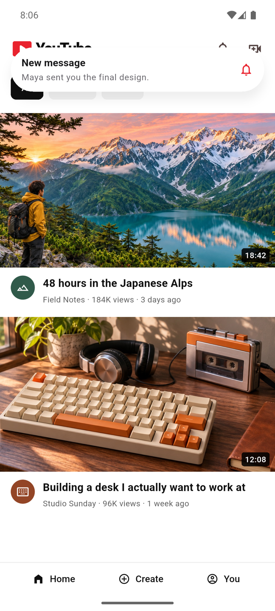
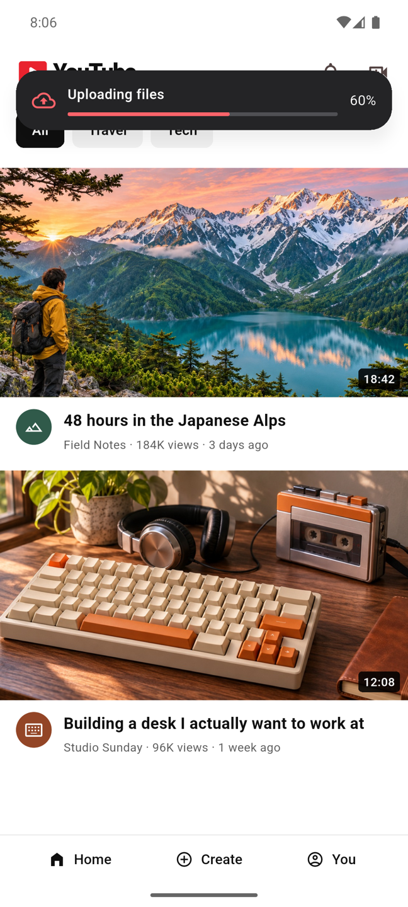

# Dynamic Notifications

**Animated, customizable in-app notifications for Flutter on iOS and Android.** A drop emerges from the top edge, expands into a notification card, and retracts when dismissed.

<p>
  
</p>

<p>
  
  
</p>

## Features

- Animated entrance and exit with adaptive placement around the screen cutout.
- Built-in card with a title, message, avatar, icon, and accent color.
- Custom background, corner radius, padding, and Flutter widget content.
- Automatic, persistent, and programmatic dismissal. Cards also respond to taps and upward swipes.
- Screen-reader announcements and support for the system's Reduce Motion setting.

## Install

Requires Flutter 3.47.2 or later and Dart 3.13.2 or later.

Once the package is available on pub.dev, run:

```sh
flutter pub add dynamic_notifications
```

For a local checkout, add a path dependency in your app's `pubspec.yaml` and run `flutter pub get`.

```yaml
dependencies:
  dynamic_notifications:
    path: ../dynamic_notifications
```

## Quick start

Create one controller, keep it in app state, and install the host above your navigator.

```dart
import 'package:dynamic_notifications/dynamic_notifications.dart';
import 'package:flutter/material.dart';

final notifications = DynamicNotificationController();

void main() => runApp(
  MaterialApp(
    builder: (context, child) => DynamicNotifications(
      controller: notifications,
      child: child!,
    ),
    home: Scaffold(
      body: Center(
        child: FilledButton(
          onPressed: () => notifications.show(
            const DynamicNotification(
              title: 'Download complete',
              message: 'Your file is ready.',
              icon: Icons.download_done,
            ),
          ),
          child: const Text('Show notification'),
        ),
      ),
    ),
  ),
);
```

Call `show` after the host mounts. If another notification is already visible, it exits first and the latest pending notification appears next.

| Option | Behavior |
| --- | --- |
| `duration` | Defaults to two seconds after the entrance finishes. Set a custom `Duration` per card or pass `null` for a persistent card. |
| `onTap` | Runs when the user taps the card. A tap also dismisses the notification. |
| `controller.dismiss()` | Closes the active card and clears any pending notification. |
| `avatar`, `icon`, `accent` | Set a circular image, an icon, and its color in the built-in card. Use an `AssetImage` for a bundled avatar or a `NetworkImage` for a remote one. |

## Adjust where the drop starts

The host uses Android cutout bounds when available and estimates the iPhone notch or Dynamic Island edge from the top safe-area inset, using overlapping origins calibrated to Apple simulator notch families. iPhone 12 and 13 share screen dimensions but have different notch depths, so the shared origin starts inside both cutouts. Display Zoom and future devices may need manual calibration. Pass `originLift: 4` to `DynamicNotifications` to raise that starting point by four logical pixels. The settled card keeps its safe-area position. The demo slider previews the adjustment.

## Customize the card

Use `style` to change the background, corner radius, and padding. Use `contentBuilder` to supply your own Flutter layout. The host still handles the entrance, swipe, and timer. Set `title` and `message` to describe your custom content for screen readers.

```dart
notifications.show(
  DynamicNotification(
    title: 'Uploading files',
    message: '60% complete',
    duration: const Duration(seconds: 4),
    style: const DynamicNotificationStyle(
      backgroundColor: Color(0xFF23372F),
      borderRadius: 20,
    ),
    contentBuilder: (context) => const Row(
      children: [
        Icon(Icons.cloud_upload_outlined, color: Colors.white),
        SizedBox(width: 12),
        Expanded(
          child: Column(
            mainAxisSize: MainAxisSize.min,
            crossAxisAlignment: CrossAxisAlignment.start,
            children: [
              Text('Uploading files', style: TextStyle(color: Colors.white)),
              SizedBox(height: 8),
              LinearProgressIndicator(value: 0.6),
            ],
          ),
        ),
      ],
    ),
  ),
);
```

## Run the example

From the repository root, run:

```sh
cd example
flutter run
```

Tap the **bell** to try the two-second card or **Create** to show the custom upload card. Open **You** to adjust the drop origin or dismiss the active card.

The motion is inspired by [expo-dynamic-notifications](https://github.com/rit3zh/expo-dynamic-notifications).

Maintained by Mohammed Hafiz. Licensed under MIT.
