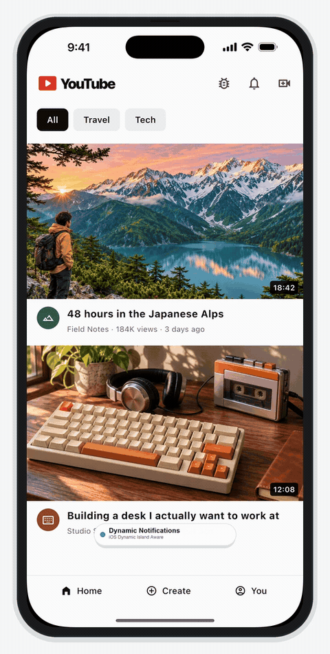

# Dynamic Notifications

Fluid, cutout-aware in-app notifications for Flutter on iOS and Android. Notifications emerge directly from your device's physical camera aperture or Dynamic Island via curve-driven fluid morphing, blossom into rounded notification cards, and retract back into the aperture upon dismissal.

[](https://pub.dev/packages/dynamic_notifications)
[](https://opensource.org/licenses/MIT)
[](https://flutter.dev)
[](https://dart.dev)
[](https://developer.android.com)
[](https://developer.apple.com/ios)

> **Note**: Android requires a small theme change to draw behind the camera cutout — see [Platform Setup](#platform-setup).

---

## Visual Demonstration

Unlike system-tray notifications that post to the OS notification center or lock screen, `dynamic_notifications` renders an in-app overlay directly inside your Flutter widget tree. Notifications emerge dynamically from the hardware camera cutout or Dynamic Island, support interactive vertical gestures, and reverse-morph back into the cutout on dismissal.

<p align="center">
  
  <br>
  <em>Captured on iPhone 17 Pro Max simulator running the example application.</em>
</p>

---

## Features

- **Curve-Driven Fluid Morph** — Natural droplet formation emerging directly from the camera cutout or Dynamic Island before settling into the notification card.
- **Hardware-Aware Geometry Detection** — Native Android `DisplayCutout` platform channel with cross-platform safe-area and `DisplayFeature` fallback.
- **Interactive Gestures** — Tap to open, swipe down to open, and swipe up to dismiss with real-time reverse morph scrubbing.
- **Press-and-Hold** — Pauses the auto-dismiss timer while the user touches and holds the card.
- **Return Animation** — Releasing a sub-threshold drag smoothly returns the card to its resting position.
- **Customizable Card Content** — Built-in standard notification cards or arbitrary widget layouts via `contentBuilder`.
- **Accessibility & Motion First** — Respects `MediaQuery.disableAnimationsOf(context)` with instant transitions, plus screen-reader announcements via `Semantics`.

---

## Installation

```sh
flutter pub add dynamic_notifications
```

---

## Quick Start

Wrap your app in `DynamicNotifications` in `MaterialApp.builder` (outside the navigator) and call `notifications.show()`:

```dart
import 'package:dynamic_notifications/dynamic_notifications.dart';
import 'package:flutter/material.dart';

final notifications = DynamicNotificationController();

void main() => runApp(const MyApp());

class MyApp extends StatelessWidget {
  const MyApp({super.key});

  @override
  Widget build(BuildContext context) {
    return MaterialApp(
      builder: (context, child) => DynamicNotifications(
        controller: notifications,
        child: child!,
      ),
      home: Scaffold(
        body: Center(
          child: FilledButton(
            onPressed: () => notifications.show(
              const DynamicNotification(
                title: 'Download complete',
                message: 'Your file is ready to view.',
                icon: Icons.download_done,
              ),
            ),
            child: const Text('Show Notification'),
          ),
        ),
      ),
    );
  }
}
```

---

## Platform Setup

### Android Setup

To allow notifications to emerge from the camera cutout, extend your Android window into the cutout area on Android 9+ (API 28+).

In `android/app/src/main/res/values-v28/styles.xml` (create this file if it does not exist), add `windowLayoutInDisplayCutoutMode` to your `NormalTheme`:

```xml
<?xml version="1.0" encoding="utf-8"?>
<resources>
    <style name="NormalTheme" parent="@android:style/Theme.Light.NoTitleBar">
        <item name="android:windowBackground">?android:colorBackground</item>
        <item name="android:windowLayoutInDisplayCutoutMode">shortEdges</item>
    </style>
</resources>
```

*(On Android 11+ / API 30+, `always` can also be used).*

Then enable edge-to-edge system UI in your Flutter `main()` entrypoint:

```dart
import 'package:flutter/material.dart';
import 'package:flutter/services.dart';

void main() {
  WidgetsFlutterBinding.ensureInitialized();
  SystemChrome.setEnabledSystemUIMode(SystemUiMode.edgeToEdge);
  runApp(const MyApp());
}
```

### iOS Setup

No native configuration or Podfile changes are required. Geometry detection on iOS is handled purely in Flutter via safe-area view padding and display features.

---

## Configuration & API Reference

### `DynamicNotifications` (Host Widget)

| Property | Type | Default | Description |
| :--- | :--- | :--- | :--- |
| `controller` | `DynamicNotificationController` | *Required* | Controller coordinating notification display and dismissals. |
| `child` | `Widget` | *Required* | The underlying widget subtree (typically your navigator from `MaterialApp.builder`). |
| `originLift` | `double` | `0.0` | Moves the automatic drop origin up by this many logical pixels (must be `>= 0`). |
| `renderMode` | `NotificationRenderMode` | `NotificationRenderMode.standard` | Rendering engine used to draw the notification silhouette and animation. |
| `gestureConfig` | `NotificationGestureConfig` | `const NotificationGestureConfig()` | Thresholds and curves for interactive drag, fling, tap, and spring return. |
| `debugShowGuides` | `bool` | `false` | Renders visual guides showing detected cutout bounds, anchor origin, and neck boundaries. |
| `geometryOverride` | `NotchGeometry?` | `null` | Manually overrides detected notch geometry (useful for testing or simulator verification). |
| `progressOverride` | `double?` | `null` | Freezes animation progress between `0.0` (cutout) and `1.0` (card) for inspection. |

### `DynamicNotificationController`

| Member | Type | Description |
| :--- | :--- | :--- |
| `show(DynamicNotification notification)` | `void` | Shows a notification. If another card is active, replaces any pending notification ("latest wins"). |
| `dismiss()` | `void` | Clears any pending notification and initiates reverse exit of the active card. |
| `interactionState` | `NotificationInteractionState` | Current interaction state of the active notification (idle, dragging, holding, dismissing, opening, returning). |
| `dragOffset` | `double` | Current vertical drag displacement in logical pixels (`0.0` when idle). |
| `morphProgress` | `double` | Current reverse morph progress into the cutout, normalized from `0.0` (resting card) to `1.0` (collapsed). |
| `currentNotification` | `DynamicNotification?` | The currently presented notification, or `null` if idle. |

### `NotificationGestureConfig`

| Property | Type | Default | Description |
| :--- | :--- | :--- | :--- |
| `dismissThreshold` | `double` | `-32.0` | Upward drag distance in logical pixels required to trigger dismissal on release (negative value). |
| `dismissVelocityThreshold` | `double` | `-320.0` | Upward fling velocity in logical pixels per second required to trigger dismissal (negative value). |
| `openThreshold` | `double` | `44.0` | Downward drag distance in logical pixels required to trigger the open action on release (positive value). |
| `openVelocityThreshold` | `double` | `320.0` | Downward fling velocity in logical pixels per second required to trigger open (positive value). |
| `maxUpwardDrag` | `double` | `-80.0` | Maximum upward drag displacement in logical pixels (negative value). |
| `maxDownwardDrag` | `double` | `120.0` | Maximum downward drag displacement in logical pixels (positive value). |
| `maxTapDuration` | `Duration` | `Duration(milliseconds: 350)` | Maximum touch duration to be recognized as a tap rather than a hold. |
| `springBackDuration` | `Duration` | `Duration(milliseconds: 260)` | Duration of the return animation when returning to resting position after sub-threshold drag. |
| `springBackCurve` | `Curve` | `Curves.easeOutCubic` | Animation curve used for the return animation. |

### `NotificationInteractionState`

- `idle` — Resting at settled position with no active touch.
- `dragging` — User is actively dragging vertically.
- `holding` — Touching and holding card in place.
- `dismissing` — Released beyond threshold or flung upward; card is exiting.
- `opening` — Tapped or swiped down beyond threshold; triggers `onTap`.
- `returning` — Released below threshold; smoothly returning to rest.

### `NotificationRenderMode`

- `NotificationRenderMode.standard` — Verified fluid morphology renderer (standard drop emergence and card transformation).

### `DynamicNotification` (Data Model)

| Property | Type | Default | Description |
| :--- | :--- | :--- | :--- |
| `title` | `String` | *Required* | Card title and primary accessibility announcement. |
| `message` | `String?` | `null` | Secondary text displayed below the title. |
| `icon` | `IconData?` | `null` | Leading icon in the built-in card. |
| `avatar` | `ImageProvider?` | `null` | Circular avatar image (takes priority over `icon`). |
| `accent` | `Color?` | `null` | Accent color applied to the leading icon. |
| `duration` | `Duration?` | `Duration(seconds: 2)` | Display time before auto-dismissal (`null` for persistent card). |
| `onTap` | `VoidCallback?` | `null` | Callback executed when tapped or swiped downward past `openThreshold`. Tap automatically dismisses the card. |
| `contentBuilder` | `WidgetBuilder?` | `null` | Custom widget layout replacing the built-in card row. |
| `style` | `DynamicNotificationStyle` | `const DynamicNotificationStyle()` | Appearance overrides (background color, border radius, padding). |

### `DynamicNotificationStyle`

| Property | Type | Default | Description |
| :--- | :--- | :--- | :--- |
| `backgroundColor` | `Color?` | `null` | Card background color. When `null`, defaults to theme card color (light `Colors.white`, dark `Color(0xFF28272A)`). |
| `borderRadius` | `double?` | `null` | Uniform corner radius in logical pixels (asserts `>= 0`). When `null`, defaults to pill shape (`36.0`). |
| `padding` | `EdgeInsetsGeometry` | `EdgeInsets.symmetric(horizontal: 16, vertical: 14)` | Insets around built-in row or custom content builder. |

### `NotchGeometry`

| Property | Type | Description |
| :--- | :--- | :--- |
| `hasCutout` | `bool` | Whether a physical cutout, notch, or island was detected. |
| `edge` | `CutoutEdge` | Screen edge where the cutout is located (`top`, `left`, `right`, `bottom`, `none`). |
| `shape` | `NotchShape` | Cutout classification (`punchHole`, `pill`, `notch`, `none`). |
| `anchorTop` | `double` | Suggested vertical anchor coordinate where the fluid droplet originates. |
| `animationOrigin` | `Offset` | 2D origin point where fluid emergence begins. |

*Additional properties (`bounds`, `center`, `width`, `height`, `screenSize`, `insets`, `source`, `confidence`, `devicePixelRatio`) are available in the API documentation.*

### `NotchGeometryDetector`

Resolves geometry from context (`detect(context)`) or metrics (`fromMediaQuery(...)`), using cached Android native results when available.

### `AndroidCutoutGeometryProvider`

Singleton platform channel client (`instance`) querying native Android `DisplayCutout` coordinates over `MethodChannel('dynamic_notifications/android_geometry')`.

### Testing Hooks

- `DynamicNotifications.sideCutoutRendererEntered` (`@visibleForTesting bool`): Verifies unified vertical morph rendering.
- `DynamicNotifications.resetSideCutoutRendererFlag()` (`@visibleForTesting void`): Resets the verification flag.

---

## Customization

Supply a `contentBuilder` to display custom layouts such as upload progress bars or media controls:

```dart
notifications.show(
  DynamicNotification(
    title: 'Uploading files',
    message: '60% complete',
    duration: null, // Persistent until dismissed
    style: const DynamicNotificationStyle(
      backgroundColor: Color(0xFF242426),
      borderRadius: 22,
    ),
    contentBuilder: (context) => const Row(
      children: [
        Icon(Icons.cloud_upload_outlined, color: Color(0xFFFF636A)),
        SizedBox(width: 12),
        Expanded(
          child: Column(
            mainAxisSize: MainAxisSize.min,
            crossAxisAlignment: CrossAxisAlignment.start,
            children: [
              Text(
                'Uploading files',
                style: TextStyle(color: Colors.white, fontWeight: FontWeight.w600),
              ),
              SizedBox(height: 8),
              LinearProgressIndicator(
                value: 0.6,
                color: Color(0xFFFF636A),
                backgroundColor: Color(0xFF505054),
              ),
            ],
          ),
        ),
        SizedBox(width: 12),
        Text('60%', style: TextStyle(color: Colors.white)),
      ],
    ),
  ),
);
```

---

## Behavior Notes

1. **Devices Without Cutouts**: On displays without physical cutouts, notifications gracefully fall back to the top safe area status bar insets with centered emergence.
2. **Single Pending Notification ("Latest Wins")**: The host maintains a single pending slot. If `controller.show()` is called while a notification is active or exiting, the new notification replaces any previous pending notification and enters once the active exit finishes.
3. **Controller Attachment & Mount Placement**: Always install `DynamicNotifications` once in `MaterialApp.builder` outside the `Navigator` so notifications overlay all routes. A single `DynamicNotificationController` can only be attached to one mounted host at a time; attaching it to a second host throws a `StateError` (*"A controller can only be attached to one host."*).
4. **Asynchronous Android Geometry**: On Android, `AndroidCutoutGeometryProvider.instance.load()` is invoked asynchronously upon initial mount. The first frame may use `MediaQuery` fallback metrics until the native platform channel completes, whereupon the host updates with exact native cutout bounds.

---

## Debugging & Testing

### Visual Guides & Geometry Override

Enable `debugShowGuides` to display color-coded on-screen guides (cutout bounds in cyan, anchor origin crosshair in red, neck attachment line in yellow, and apex in green). Use `geometryOverride` to simulate specific cutouts during testing:

```dart
DynamicNotifications(
  controller: notifications,
  debugShowGuides: true, // Cyan cutout bounds, red origin, yellow neck, green apex
  geometryOverride: const NotchGeometry(
    bounds: Rect.fromLTWH(180, 0, 34, 34),
    center: Offset(197, 17),
    width: 34,
    height: 34,
    top: 0,
    bottom: 34,
    screenSize: Size(393, 852),
    insets: EdgeInsets.only(top: 47),
    source: NotchGeometrySource.safeArea,
    confidence: NotchGeometryConfidence.fallback,
    shape: NotchShape.punchHole,
    hasCutout: true,
  ),
  child: child!,
)
```

### Freezing Animation Progress

Set `progressOverride` (between `0.0` and `1.0`) to freeze the morph animation at a fixed stage for visual seam inspection or screenshot tests. This displays a placeholder "Geometry Validation" card:

```dart
DynamicNotifications(
  controller: notifications,
  progressOverride: 0.45, // Freezes animation at 45% progress and shows validation card
  child: child!,
)
```

---

## Architecture Overview

1. **Geometry Stage**: Resolves physical aperture bounds, horizontal anchor, and drop origin via native Android channel or Flutter metrics.
2. **Droplet Emergence**: An elongated teardrop path emerges from the cutout anchor and extends downward using staged transition curves.
3. **Card Morph**: The droplet expands outward and morphs into the settled notification card.
4. **Gestures & Dismissal**: Dragging upward reverses the morph into the cutout; dragging downward or tapping triggers `onTap`. Sub-threshold releases smoothly return to rest via a 260 ms cubic ease-out curve, while dismissals and timeouts play the entrance animation in reverse.

---

## Running the Example

```sh
cd example && flutter run
```

---

## Community & Contributing

- **Issues & Bug Reports**: [GitHub Issues](https://github.com/MohammedHafiz27/dynamic_notifications/issues)
- **Source Repository**: [MohammedHafiz27/dynamic_notifications](https://github.com/MohammedHafiz27/dynamic_notifications)
- **Release History**: [CHANGELOG.md](CHANGELOG.md)

---

## License & Attribution

- Released under the [MIT License](LICENSE). Maintained by **Mohammed Hafiz**.
- Motion concept inspired by [expo-dynamic-notifications](https://github.com/rit3zh/expo-dynamic-notifications).
